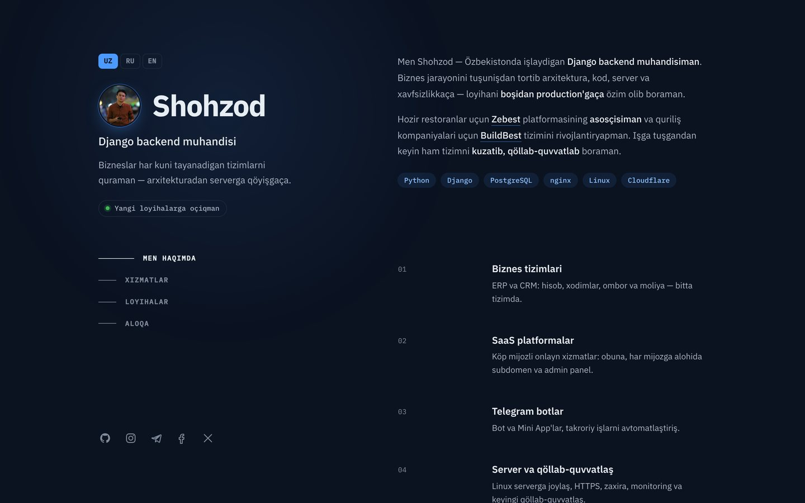

# Shohzod — Developer Portfolio

[](https://github.com/ShohzoDev/my-portfolio/actions/workflows/tests.yml)

Personal portfolio of a Django backend engineer, built with Django 5.2.
Server-rendered, trilingual (Uzbek / Russian / English), plain HTML and CSS
plus one small script that only adds polish.

[O'zbekcha qo'llanma → README.uz.md](README.uz.md)



## What's inside

- **Header + full-screen hero:** logo, section menu (underlines the section
  you are reading), language toggle and a "Let's talk" button; the hero says
  hello and shows a Python code window that types itself out. Below:
  About, Services, Projects and Contact, each opening with a `// eyebrow`
  and a big title.
- **Projects as a directory of links.** Every project already has its own
  live site, so each row is just the name, one line and the domain, and
  the whole row opens the site.
- **One URL per language** (`/uz/`, `/ru/`, `/en/`) with `hreflang`,
  canonical links, a sitemap and JSON-LD (`Person`).
- **Editable in the admin:** owner name, projects (name, one-line
  description, link, status) in three languages, and social links. Social
  links without a URL stay hidden; the Telegram link becomes the main
  button.
- **Security:**
  - strict Content-Security-Policy (`script-src 'self'`, no inline code)
    and a Permissions-Policy;
  - admin login throttling and a configurable admin path;
  - production hardening (HSTS, secure cookies, SSL redirect);
  - errors are logged to stderr.
- **Performance:** self-hosted IBM Plex fonts with only the needed unicode
  subsets, AVIF/WebP photo, WhiteNoise compressed and hashed static files.

## Stack

Python · Django 5.2 · SQLite or PostgreSQL · WhiteNoise · hand-written CSS

## Run locally

```bash
python -m venv .venv
source .venv/bin/activate          # Windows: .venv\Scripts\activate
pip install -r requirements.txt
cp .env.example .env               # optional, defaults work for development
python manage.py migrate
python manage.py createsuperuser
python manage.py runserver
```

Open http://127.0.0.1:8000/. It redirects to `/uz/`, `/ru/` or `/en/`
based on a saved choice or the browser language. The admin is at `/admin/`,
or at whatever `DJANGO_ADMIN_URL` is set to.

## Tests

```bash
python manage.py test
```

The suite covers:

- routing and language detection;
- SEO output (hreflang, canonical, JSON-LD, sitemap);
- the one-page layout, the project list and the content migrations;
- CSP (no inline scripts or styles);
- admin login throttling.

GitHub Actions runs it on every push.

## Configuration

All settings come from environment variables (`.env` in development). See
[`.env.example`](.env.example). The ones that matter in production:

| Variable | Purpose |
|---|---|
| `DJANGO_DEBUG=False`, `DJANGO_SECRET_KEY` | required; the site refuses to start with the dev key |
| `DJANGO_ALLOWED_HOSTS`, `DJANGO_CSRF_TRUSTED_ORIGINS` | your domain |
| `DJANGO_ADMIN_URL` | non-default admin path, e.g. `manage-7f3k/` |
| `SITE_CONTACT_EMAIL` | shown on the site; the e-mail block stays hidden until it is set |
| `CONTACT_TRUST_PROXY_HEADERS=True` | only behind nginx / PythonAnywhere, so the admin login limit sees the real client IP |

Deployment notes for PythonAnywhere and an nginx + gunicorn VPS are in
[README.uz.md](README.uz.md).

## License

Code: [MIT](LICENSE). Text content, photos and project descriptions are
© Shohzod, all rights reserved. Fonts are under the SIL Open Font
License; see `static/portfolio/fonts/`.
